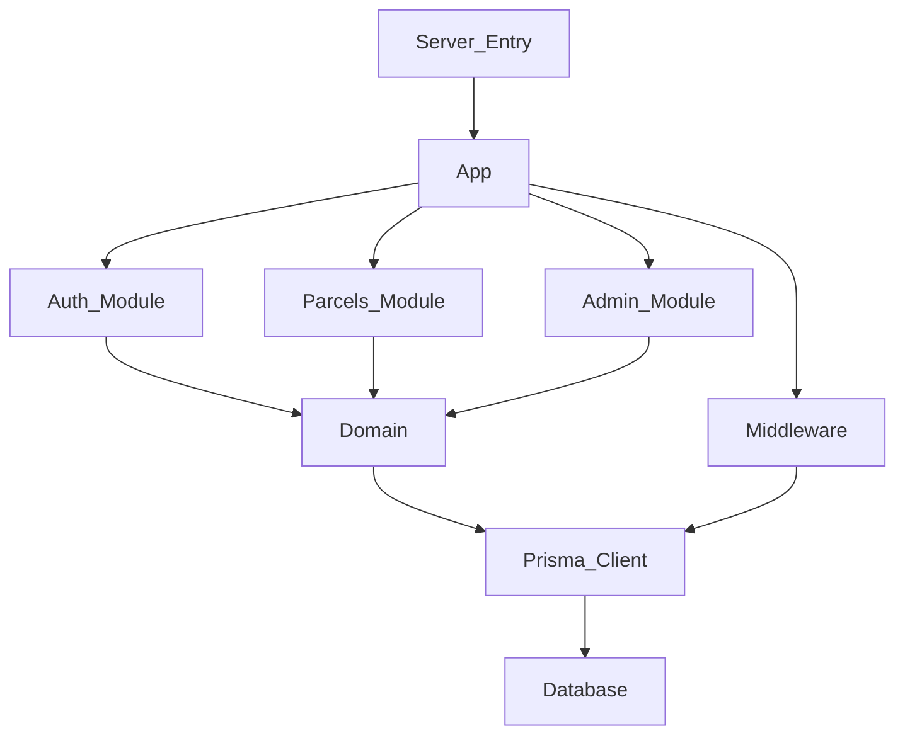

## Stack
- Node.js 22, Express 5, PostgreSQL 16 via Prisma 6, Zod 4 (env/input validation).
- Auth: `jsonwebtoken`, `bcryptjs`. Rate limiting: `express-rate-limit` + `rate-limit-redis`/`ioredis` (optional Redis).
- ESM (`"type": "module"` in package.json). Security headers via `helmet`, CORS via `cors`.

## Directory map
| path | what lives there |
|---|---|
| `src/app.js` | Express app factory (`createApp`) — middleware, routes, health checks |
| `src/server.js` | Process entry — binds port, graceful shutdown |
| `src/config/env.js` | Zod-validated environment config |
| `src/lib/prisma.js` | Prisma client instance |
| `src/lib/logger.js` | Logger |
| `src/middleware/` | `authenticate.js`, `authorize.js`, `validate.js`, `requestId.js`, `requestLogger.js`, `rateLimit.js`, `notFound.js`, `errorHandler.js` |
| `src/utils/` | `response.js`, `password.js`, `jwt.js`, `AppError.js`, `trackingCode.js` |
| `src/domain/parcelStatus.js` | Parcel status flow domain logic |
| `src/modules/auth/` | Auth routes/controller (`auth.routes.js`) |
| `src/modules/parcels/` | Parcels routes/controller (`parcels.routes.js`) |
| `src/modules/admin/` | Admin routes/controller (`admin.routes.js`) |
| `prisma/schema.prisma` | Database schema |
| `prisma/migrations/` | Migration history |
| `prisma/seed.js` | Seed script (users, parcels) |
| `docker/init-test-db.sql` | Test DB init SQL |
| `docker-compose.yml` | Local Postgres/Redis containers |
| `scripts/check.sh` | Full-stack health check script |
| `docs/` | `architecture.md`, diagrams (`docs/diagrams/*.mmd`), project docs (pdf/docx/html) |

## Diagram

## Component index
- [[Server_Entry]]
- [[App]]
- [[Middleware]]
- [[Auth_Module]]
- [[Parcels_Module]]
- [[Admin_Module]]
- [[Domain]]
- [[Prisma_Client]]
- [[Database]]

## Entry points
- Dev: `npm run dev` → `node --watch --env-file=.env src/server.js`
- Prod: `npm start` → `node src/server.js`
- `src/server.js` imports `createApp` from `src/app.js` (no port binding there, so tests can drive it with supertest per comment in `src/app.js`).

## Conventions
- `src/app.js` explicitly states: "server.js is the only place that calls listen()".
- Route mounting in `src/app.js`: `/auth` → `authRouter`, `/parcels` → `parcelsRouter`, `/admin` → `adminRouter`.
- Middleware order in `src/app.js`: `requestId` first ("so every later failure can carry the id"), then `helmet`, `cors`, `express.json({ limit: '100kb' })`, `requestLogger`, then routes, then `notFound`, then `errorHandler` last.
- Two health endpoints: `/health` (shallow, no DB) and `/health/db` (deep, runs `SELECT 1` via Prisma), per comments in `src/app.js`.
- Responses use shared helpers `sendSuccess`/`sendError` from `src/utils/response.js`.
- `.env` read via Node's native `process.loadEnvFile()` per README (requires Node 22, no `dotenv` dependency).

## Where things go
- To add a new resource/feature area: create `src/modules/<name>/<name>.routes.js` (+ controller/service files), mount it in `src/app.js` alongside `authRouter`/`parcelsRouter`/`adminRouter`.
- To change DB schema: edit `prisma/schema.prisma`, run `npm run db:migrate`, review generated file under `prisma/migrations/`.
- To add/change env vars: update `src/config/env.js` (Zod schema) and `.env.example`.
- To add cross-cutting request behavior: add a file under `src/middleware/` and wire it into `src/app.js`.
- To change parcel status rules: edit `src/domain/parcelStatus.js`.
